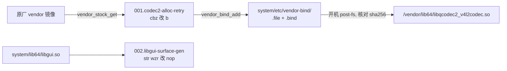

# tb321fu-video-freeze-patch — 设计

## 多语言

**简体中文** | [English](en/DESIGN.md) | [Español](es/DESIGN.md)

## 文档

- 项目概览: [README](../README.md)

- 设计思路: [DESIGN](DESIGN.md)

- 项目状态: [LOG](LOG.md)
- 历史记录: [HISTORY](HISTORY.md)
- 变更日志: [CHANGELOG](CHANGELOG.md)

- 第三方声明: [THIRD_PARTY_NOTICES](THIRD_PARTY_NOTICES.md)

## 设计目标

- [x] 修复 TB321FU 刷 Pixel GSI 后刷视频时声音继续, 画面定格的问题.
- [x] 不修改原厂 vendor 分区; vendor 侧的改动随 system 镜像分发, 开机核对原厂文件后才生效.
- [x] 换底包或换固件时, 补丁位置找不到或不唯一就停止构建, 不产出改错的镜像.
- [x] 仓库不含任何联想, 高通或 Google 的二进制文件.
- 非目标: 支持 TB321FU 以外的设备. 其他设备的排查和修复方法由 [gsi-codec2-video-freeze-guide](https://github.com/CharlesGool/gsi-codec2-video-freeze-guide) 说明.

## 架构

本项目是 [TB321FU-GSI-Mods](https://github.com/CharlesGool/TB321FU-GSI-Mods) 的一个补丁. Mods 的构建系统读取 `patch/patch.conf`, 执行 `patch/apply.sh`; `apply.sh` 用 Mods 的 `run_parts` 按编号执行两个部分的 `part.sh`.

- `001.codec2-alloc-retry`: 从原厂 vendor 镜像取出库, 打补丁, 用 Mods 的 vendor-bind 机制 (`toolkit/lib/vendorbind.sh`) 登记; 开机时 `vendor-bind.sh` 核对原厂文件 sha256, 一致才 bind.
- `002.libgui-surface-gen`: 原地修改 system 树里的 `lib64/libgui.so`, 保留属主, 权限和 SELinux 标签; libgui 没有对应指令 (A15/A16) 时跳过.
- 两个部分之间没有依赖, 修的是同一现象的两个原因.

| 顶层目录 | 职责 |
| --- | --- |
| `patch/` | 补丁本体, 同步到 Mods 的 `patches/required/general/hardware-fix/video-freeze-fix/`. `patch.conf` 是元数据, `apply.sh` 是入口, `parts/NNN.<部分>/` 下是各部分的脚本, 定位工具和说明 |
| `tools/` | 不用 Mods 时直接改已挂载镜像的脚本 |
| `doc/` | 项目文档. 调研记录和通用方法在 [gsi-codec2-video-freeze-guide](https://github.com/CharlesGool/gsi-codec2-video-freeze-guide) |

本项目没有界面文本, 也没有构建输出; 构建输出在 Mods 的 `out/`.

## 设计约束

- 原厂库和补丁后的库**禁止**进仓库.
- 定位工具**禁止**写死文件偏移, 只能按符号和指令模式查找; 命中数不是 1 时**必须**停止.
- vendor-bind 描述符里的原文件 sha256 **必须**在构建时从取出的原厂文件现算.
- 补丁后的文件与原文件的差异**必须**在 1 到 4 字节之间, 否则停止.
- `patch/` 的修改**必须**先在本仓库提交, 再同步到 Mods.

## 外部接口

| 接口 | 提供方 | 用途 |
| --- | --- | --- |
| 补丁格式 (`patch.conf`, `apply.sh`, `run_parts`) 和构建函数 (`replace`, `need_file`, `die`) | TB321FU-GSI-Mods | 修改 system 树 |
| `vendor_stock_get`, `vendor_bind_add`, 开机脚本 `vendor-bind.sh` | TB321FU-GSI-Mods `toolkit/lib/vendorbind.sh`, `toolkit/vendor-bind/` | 取原厂库, 开机 bind 到 `/vendor` |
| `STOCK_VENDOR_IMG`, `DEVICE` | Mods 的 `devices/<设备>/device.conf` | 原厂 vendor 镜像和设备守护 |
